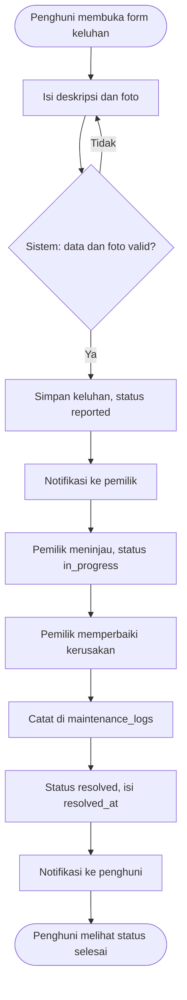
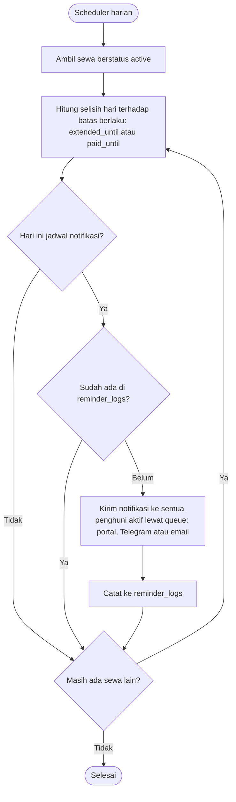
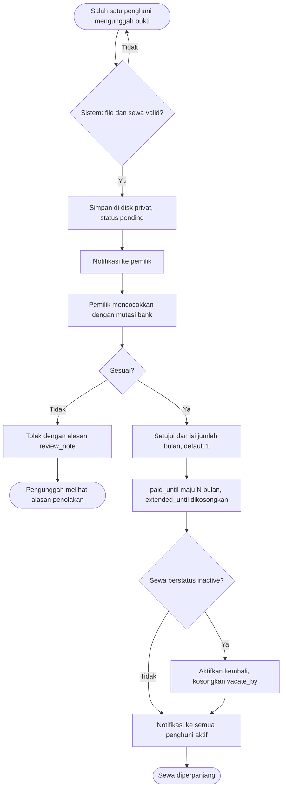
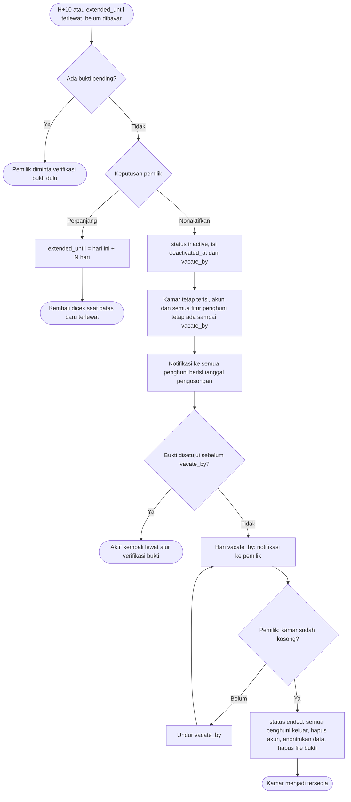
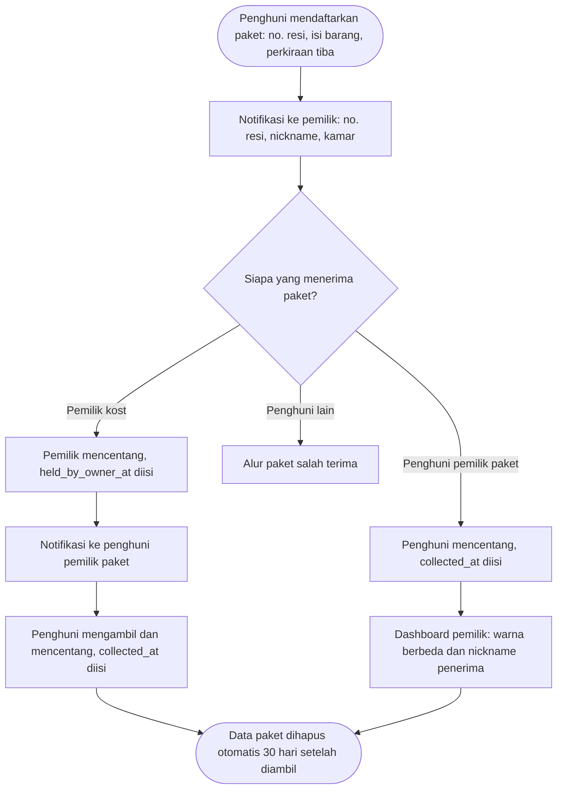

# Peran dan Alur Bisnis

## Peran dan hak akses

| Peran                    | Bisa                                                                                                                                                                                                                                                                       | Tidak bisa                                                                                                                                                                                               |
| ------------------------ | -------------------------------------------------------------------------------------------------------------------------------------------------------------------------------------------------------------------------------------------------------------------------- | -------------------------------------------------------------------------------------------------------------------------------------------------------------------------------------------------------- |
| **Publik** (tanpa login) | Melihat profil kost, foto, fasilitas, aturan, lokasi, dan status kamar (tersedia/terisi). Mengisi form survei/daftar tunggu                                                                                                                                                | Melihat siapa penghuni kamar mana                                                                                                                                                                        |
| **Penghuni** (`tenant`)  | Melihat kamarnya sendiri dan tanggal `paid_until`. Mengunggah bukti transfer, melapor dan memantau keluhan, membaca pengumuman, membuka halaman "Data saya", mengatur notifikasi Telegram/email, mendaftarkan dan memantau paket pesanannya, melaporkan paket salah terima | Melihat data atau keluhan penghuni kamar lain. Melihat gambar bukti transfer dan kontak notifikasi teman sekamar. Melihat paket pesanan penghuni lain, termasuk teman sekamar. Menghapus akunnya sendiri |
| **Pemilik** (`owner`)    | Semuanya: kamar dan foto, data sewa, verifikasi bukti, keputusan penonaktifan, keluhan, perawatan, inventaris, pengumuman, permintaan survei, serta menerima paket penghuni (no. resi, nickname, kamar)                                                                    | Melihat nama/isi barang paket pesanan penghuni                                                                                                                                                           |

- Akun penghuni dibuat oleh pemilik. Tidak ada registrasi publik. Lihat "Akun penghuni" di bawah.
- Hak penghuni berlaku selama ia **belum keluar** (`moved_out_at` kosong) dari sewa yang masih menempati kamar (`active` atau `inactive`). Begitu keluar atau sewanya `ended`, aksesnya ke data kamar itu tertutup.
- Penghuni **nonaktif** tetap bisa memakai semua fitur penghuni sampai tanggal pengosongan: melihat info sewa, mengunggah bukti transfer, membaca pengumuman, memakai fitur paket, dan melapor keluhan. Halamannya menonjolkan tanggal pengosongan.
- Penghuni tanpa akun tetap tercatat. Pemilik yang mencatat keluhan atau pembayarannya.
- Halaman "Data saya" menampilkan semua data tentang penghuni itu yang tersimpan di sistem (data penghuninya sendiri dan data sewa kamarnya), sebagai bentuk transparansi.

### Teman sekamar

Satu kamar bisa dihuni maksimal `rooms.capacity` orang (default 2) dengan satu sewa dan satu tagihan bersama. Kedua penghuni bisa mengunggah bukti transfer, dan bukti dari siapa pun memajukan `paid_until` kamar itu.

Orang kedua hanya bisa masuk kalau kamar berstatus **"bersedia berbagi kamar"**, dan biasanya ia kenalan penghuni pertama, misalnya teman sekantor atau sekampus. Status ini dinyalakan oleh penghuni kamar itu atau oleh pemilik. Tanpa status itu, kamar dianggap penuh walaupun baru berisi 1 orang. Aturan lengkapnya ada di `docs/database.md`, bagian "Penghuni per kamar".

| Data                                               | Terlihat oleh teman sekamar?                                                                                                       |
| -------------------------------------------------- | ---------------------------------------------------------------------------------------------------------------------------------- |
| Nickname                                           | Ya                                                                                                                                 |
| Tanggal `paid_until` dan status sewa               | Ya                                                                                                                                 |
| Keluhan kamar beserta fotonya                      | Ya, karena keluhan menyangkut kamar bersama. Hanya keluhan selama sewa yang sedang berjalan, bukan keluhan penghuni lama kamar itu |
| Status bukti transfer (menunggu/disetujui/ditolak) | Ya                                                                                                                                 |
| Gambar bukti transfer                              | Tidak. Hanya pengunggah dan pemilik (memuat nama/rekening bank)                                                                    |
| Kontak notifikasi (`notify_contact`)               | Tidak                                                                                                                              |

### Matriks hak akses

Semua aturan ini dicek di server lewat Policy (`app/Policies`) dan diuji untuk setiap jenis pengguna di `tests/Feature/Policies`. "Penghuni" berarti penghuni yang belum keluar dari sewa `active`/`inactive`. Penghuni yang sudah keluar tidak punya akses apa pun ke data kamar lamanya.

| Aksi                                   | Pemilik kost                           | Penghuni (dirinya/kamarnya)                | Teman sekamar        | Penghuni kamar lain  |
| -------------------------------------- | -------------------------------------- | ------------------------------------------ | -------------------- | -------------------- |
| Lihat sewa dan `paid_until`            | Ya                                     | Ya                                         | Ya                   | Tidak                |
| Kelola sewa (buat, ubah, keputusan)    | Ya                                     | Tidak                                      | Tidak                | Tidak                |
| Ubah status "bersedia berbagi kamar"   | Ya                                     | Ya, selama sewa aktif                      | Ya                   | Tidak                |
| Lihat status bukti transfer            | Ya                                     | Ya                                         | Ya                   | Tidak                |
| Buka gambar bukti transfer             | Ya                                     | Hanya pengunggah                           | Tidak                | Tidak                |
| Unggah bukti transfer                  | Ya, atas nama penghuni                 | Ya                                         | Ya                   | Tidak                |
| Setujui/tolak bukti                    | Ya, hanya yang `pending`               | Tidak                                      | Tidak                | Tidak                |
| Lihat keluhan kamar                    | Ya                                     | Ya, selama sewa berjalan                   | Ya                   | Tidak                |
| Lapor keluhan                          | Ya, atas nama penghuni                 | Ya                                         | Ya                   | Tidak                |
| Ubah status atau hapus keluhan         | Ya                                     | Tidak                                      | Tidak                | Tidak                |
| Baca pengumuman                        | Ya, termasuk terjadwal dan kedaluwarsa | Ya, yang sedang tayang                     | Ya                   | Ya, kost yang sama   |
| Kelola pengumuman                      | Ya                                     | Tidak                                      | Tidak                | Tidak                |
| Lihat paket (resi, status)             | Ya, semua paket                        | Paketnya sendiri                           | Tidak                | Tidak                |
| Lihat nama/isi barang paket            | **Tidak**                              | Paketnya sendiri                           | Tidak                | Tidak                |
| Daftarkan paket                        | Tidak                                  | Ya, paketnya sendiri                       | Ya, paketnya sendiri | Ya, paketnya sendiri |
| Ubah atau batalkan paket               | Tidak                                  | Paketnya sendiri, selama menunggu          | Tidak                | Tidak                |
| Centang "sudah di rumah pemilik"       | Ya, selama menunggu                    | Tidak                                      | Tidak                | Tidak                |
| Centang "sudah diterima"               | Tidak                                  | Paketnya sendiri, sebelum diterima         | Tidak                | Tidak                |
| Laporkan paket salah terima            | Tidak                                  | Ya                                         | Ya                   | Ya                   |
| Lihat laporan salah terima             | Ya                                     | Hanya pelapor                              | Tidak                | Tidak                |
| Tautkan atau selesaikan laporan        | Ya, selama belum selesai               | Tidak                                      | Tidak                | Tidak                |
| Buat akun atau reset password penghuni | Ya, reset dengan password pemilik      | Tidak (ganti password sendiri di Settings) | Tidak                | Tidak                |

Pemilik kost **tidak** diberi akses otomatis ke semua hal (tanpa `Gate::before()`), karena ada data yang memang tidak boleh ia lihat, yaitu isi paket penghuni.

### Akun penghuni

1. Pemilik mencatat penghuni (cukup nickname), lalu membuatkan akun login dari halaman detail sewa: username (huruf, angka, `-`, `_`) dan email opsional.
2. Sistem membuat **password sementara** dengan format `bulan-tanggal-kamar-idAkun-KODE-tahun` dari tanggal masuk penghuni, misalnya `07-15-3-9-K7P4QZ-2026`. Hanya `KODE` yang rahasia: 6 karakter acak (`random_int`) tanpa karakter yang mudah tertukar (I, L, O, 0, 1). Bagian lain bisa ditebak teman sekamar, tapi dengan batas 5 percobaan login per menit, menebak KODE butuh ratusan tahun.
3. Password sementara **ditampilkan sekali** kepada pemilik (flash), lalu diserahkan langsung atau lewat pesan pribadi. Server hanya menyimpan hash-nya.
4. Selama masih memakai password sementara (`users.has_temporary_password`), dashboard penghuni menampilkan **pengingat** untuk menggantinya. Ini tidak wajib. Pengingat hilang begitu penghuni mengganti password di Settings atau lewat link reset email.
5. **Reset oleh pemilik** (terutama untuk akun tanpa email) membuat password sementara baru dengan format yang sama, meminta password pemilik sebagai konfirmasi, dan mengeluarkan penghuni dari semua perangkat (sesi dihapus, `remember_token` diganti). Akun pemilik tidak bisa direset lewat jalur ini.

## Jadwal notifikasi

| Waktu (relatif ke `paid_until`) | Penerima                             | Isi                                                 |
| ------------------------------- | ------------------------------------ | --------------------------------------------------- |
| H-3 dan H-0                     | Semua penghuni aktif                 | Pengingat jatuh tempo (tanggal saja, tanpa nominal) |
| H+1, H+4, H+7                   | Semua penghuni aktif                 | Pengingat masa tenggang                             |
| H+10                            | Pemilik                              | Minta keputusan: perpanjang N hari atau nonaktifkan |
| `extended_until` terlewat       | Pemilik                              | Minta keputusan lagi                                |
| Hari `vacate_by`                | Pemilik                              | Konfirmasi kamar sudah kosong                       |
| Bukti diunggah                  | Pemilik                              | Ada bukti menunggu verifikasi                       |
| Bukti disetujui                 | Semua penghuni aktif                 | Sewa diperpanjang sampai `paid_until` baru          |
| Bukti ditolak                   | Pengunggah                           | Hasil verifikasi dan alasan penolakan               |
| Keluhan baru / selesai          | Pemilik / semua penghuni aktif kamar | Status keluhan                                      |
| Paket didaftarkan               | Pemilik                              | No. resi, nickname, kamar, perkiraan tiba           |
| Pemilik menerima paket          | Penghuni pemilik paket               | Paket sudah di rumah pemilik dan bisa diambil       |
| Laporan paket salah terima      | Pemilik                              | Ada paket yang diterima orang yang salah            |
| Laporan ditautkan ke paket      | Penghuni pemilik paket               | Paketnya salah diterima dan sedang diurus pemilik   |

Saluran ke penghuni: notifikasi di portal (selalu), ditambah Telegram atau email kalau penghuni itu mengaktifkannya. Pengaturan ini per orang, bukan per kamar.

## Alur keluhan

- Penghuni melapor dari menu "Complaints". Kamar diambil dari sewa yang sedang ia tempati, bukan dipilih di form, jadi ia tidak bisa melapor atas nama kamar lain.
- Pelapor dan status diisi sistem. Nilai `room_id`, `reporter_id`, atau `status` yang dikirim dari form diabaikan.
- Foto opsional, disimpan di disk privat (lihat "File" di `docs/database.md`). Kalau penyimpanan gagal di tengah jalan, foto yang sudah tersimpan ikut dihapus, supaya tidak ada foto kamar yang tertinggal tanpa catatan.
- Pemilik mengelola keluhan semua kamar dari menu "Complaints" miliknya, dengan filter terbuka/selesai/semua:
    - "Start work" mengubah status menjadi `in_progress`.
    - "Resolve" mengubah status menjadi `resolved` dan mengisi `resolved_at`. Catatan perbaikan opsional (apa yang dikerjakan dan tanggalnya) masuk ke `maintenance_logs` yang tertaut ke keluhan itu.
    - "Reopen" mengembalikan status ke `in_progress` dan mengosongkan `resolved_at`. Catatan perbaikan yang sudah ada tetap tersimpan.
- Pemilik bisa mencatat keluhan atas nama penghuni tanpa akun dengan memilih kamarnya. `reporter_id` dibiarkan kosong, karena yang mengalami masalah bukan pemilik.
- Menghapus keluhan hanya untuk keluhan ganda atau salah catat. Fotonya ikut dihapus dari disk, sedangkan catatan perbaikannya tetap ada dengan `complaint_id` kosong.
- Notifikasi dikirim mulai Fase 3. Sampai saat itu, keluhan baru terlihat dari angka "keluhan terbuka" di dashboard pemilik. Angka itu juga menjadi tautan ke daftar keluhan.

## Pengumuman

1. Pemilik menulis pengumuman dari menu "Announcements": judul, isi, "tayang mulai" (tanggal + jam WIB, bawaannya sekarang), dan "tayang sampai" yang opsional (harus setelah tayang mulai).
2. Status dihitung dari kedua waktu itu, tidak disimpan:
    - _Scheduled_: belum tayang.
    - _Live_: sedang tayang.
    - _Expired_: sudah lewat batas tayang.

    Tepat pada waktu tayang mulai, statusnya sudah _Live_. Tepat pada batas tayang, statusnya sudah _Expired_.

3. Pemilik melihat semua pengumuman di halamannya, termasuk yang terjadwal dan kedaluwarsa. Penghuni, termasuk penghuni nonaktif, hanya melihat pengumuman _Live_ dari kost tempat ia tinggal: 3 terbaru di dashboard dan semuanya di menu "Announcements".
4. Notifikasi saat pengumuman tayang dikirim mulai Fase 3.

## Alur pengingat harian (scheduler, 08.00 WIB)

Kalau pengiriman ke Telegram/email gagal, job queue mencoba ulang beberapa kali sebelum ditandai gagal.

## Alur unggah dan verifikasi bukti transfer

Pemilik **wajib** mencocokkan dengan mutasi rekening, bukan hanya melihat gambar, karena bukti transfer mudah diedit. Antarmuka persetujuan perlu menampilkan pengingat ini.

## Alur keputusan, penonaktifan, dan pengosongan

Akun **tidak pernah** dihapus otomatis. Menjawab "Ya" pada "kamar sudah kosong?" adalah persetujuan pemilik untuk menghapus akun semua penghuni kamar itu. Langkah ini sebaiknya meminta konfirmasi password (fitur password confirmation sudah aktif).

## Alur satu penghuni keluar (sewa berlanjut)

Dipakai kalau satu orang pindah sementara teman sekamarnya tetap tinggal.

1. Penghuni memberi tahu pemilik bahwa ia akan keluar.
2. Setelah penghuni itu benar-benar pindah, pemilik menandainya keluar dari halaman sewa kamar, dengan konfirmasi password.
3. Sistem mengisi `moved_out_at`, menghapus file bukti transfer yang pernah diunggahnya, menghapus akunnya, lalu mengosongkan nickname dan kontaknya. Detailnya ada di `docs/database.md` bagian "Penghuni keluar".
4. Sewa kamar tetap `active` dengan `paid_until` yang sama. Harga untuk jumlah penghuni yang baru disepakati dan dicatat pemilik di luar sistem.
5. Kalau ia penghuni aktif terakhir, pakai alur pengosongan di atas (sewa `ended`), bukan alur ini.

## Alur paket pesanan

Nama/isi barang hanya terlihat oleh penghuni pemilik paket. Pemilik kost hanya melihat no. resi, nickname, kamar, perkiraan tiba, dan status. Penghuni lain, termasuk teman sekamar, tidak melihat apa pun.

### Paket salah terima

1. Penghuni yang menerima paket bukan miliknya membuka halaman paket dan mengisi form "Saya menerima paket yang bukan milik saya", berisi no. resi atau nama di label. Ia tetap tidak bisa melihat daftar paket orang lain.
2. Laporan disimpan di `parcel_reports`, dan pemilik menerima notifikasi.
3. Pemilik mencocokkan laporan dengan daftar paket, lalu menautkannya ke paket yang benar (`parcel_id`).
4. Saat laporan ditautkan, penghuni pemilik paket menerima notifikasi bahwa paketnya salah diterima dan sedang diurus pemilik. Identitas pelapor tidak disebutkan.
5. Paket diserahkan ke pemilik, lalu pemilik mencentang "sudah di rumah" dan alur normal berlanjut. Laporan ditandai selesai (`resolved_at`).
6. Kalau resinya tidak terdaftar oleh siapa pun, pemilik mengurusnya di luar sistem lalu menandai laporan selesai.

## Alur permintaan survei (publik)

1. Calon penyewa mengisi form di halaman publik: nama dan kontak (nomor WhatsApp atau email) wajib, sedangkan tanggal survei (tidak boleh tanggal lampau) dan pesan opsional. Form menampilkan catatan bahwa data hanya dipakai untuk mengatur survei dan dihapus 30 hari setelah selesai.
2. Form dibatasi **5 kiriman per jam per alamat IP** (`throttle:rental-inquiries`). Kiriman ke-6 ditolak dengan HTTP 429.
3. Disimpan di `rental_inquiries` dengan status `new`. Status dan `done_at` tidak bisa diisi dari form. Pemilik menerima notifikasi (dibuat bersama sistem notifikasi di Fase 3).
4. Pemilik menghubungi, lalu mengubah status ke `contacted` dan akhirnya `done` (`done_at` diisi).
5. Data dihapus otomatis 30 hari setelah `done_at`.
