# Desain Database

Database: PostgreSQL. Tabel bawaan Laravel (`sessions`, `password_reset_tokens`, `cache`, `jobs`, `failed_jobs`, `notifications`) tidak digambar di sini.

Tidak ada kolom uang di tabel mana pun. Sistem tidak memproses pembayaran dan tidak menyimpan nominal transfer.

## ERD

```mermaid
erDiagram
    USERS ||--o{ PROPERTIES : memiliki
    PROPERTIES ||--|{ ROOMS : punya
    ROOMS ||--o{ ROOM_PHOTOS : punya
    ROOMS ||--o{ TENANCIES : disewa
    TENANCIES ||--|{ TENANCY_OCCUPANTS : dihuni
    USERS |o--o{ TENANCY_OCCUPANTS : login_sebagai
    TENANCIES ||--o{ PAYMENT_PROOFS : punya
    USERS |o--o{ PAYMENT_PROOFS : mengunggah
    TENANCIES ||--o{ TENANCY_DECISIONS : punya
    TENANCIES ||--o{ REMINDER_LOGS : mencatat
    ROOMS ||--o{ COMPLAINTS : punya
    USERS |o--o{ COMPLAINTS : melapor
    COMPLAINTS ||--o{ COMPLAINT_PHOTOS : punya
    PROPERTIES ||--o{ ANNOUNCEMENTS : punya
    PROPERTIES ||--o{ MAINTENANCE_LOGS : punya
    ROOMS |o--o{ MAINTENANCE_LOGS : dirawat
    COMPLAINTS |o--o{ MAINTENANCE_LOGS : ditindaklanjuti
    PROPERTIES ||--o{ INVENTORY_ITEMS : punya
    ROOMS |o--o{ INVENTORY_ITEMS : berisi
    PROPERTIES ||--o{ RENTAL_INQUIRIES : menerima
    USERS ||--o{ PARCELS : memesan
    USERS |o--o{ PARCEL_REPORTS : melapor
    PARCELS |o--o{ PARCEL_REPORTS : dilaporkan

    USERS {
        bigint id PK
        string name
        string username UK
        string email UK "nullable"
        string password "hash"
        boolean has_temporary_password "default false"
        string role "owner atau tenant, default tenant"
    }
    PROPERTIES {
        bigint id PK
        bigint owner_id FK "restrictOnDelete"
        string name
        text address
        text description
        text rules
    }
    ROOMS {
        bigint id PK
        bigint property_id FK "restrictOnDelete"
        string number "unik per property"
        smallint capacity "maks penghuni, default 2"
        text facilities
        boolean is_published "default false"
    }
    ROOM_PHOTOS {
        bigint id PK
        bigint room_id FK "cascadeOnDelete"
        string path "disk publik"
        int sort_order "default 0"
    }
    TENANCIES {
        bigint id PK
        bigint room_id FK "restrictOnDelete"
        date start_date
        date paid_until "tanggal bayar berikutnya"
        date extended_until "nullable"
        string status "active, inactive, ended"
        boolean accepts_roommate "bersedia berbagi kamar, default false"
        timestamp deactivated_at "nullable"
        date vacate_by "nullable"
        date end_date "nullable"
    }
    TENANCY_OCCUPANTS {
        bigint id PK
        bigint tenancy_id FK "cascadeOnDelete"
        bigint user_id FK "nullable, nullOnDelete"
        string nickname "nullable"
        date moved_in_at
        date moved_out_at "nullable"
        string notify_channel "nullable: telegram, email"
        string notify_contact "nullable"
    }
    PAYMENT_PROOFS {
        bigint id PK
        bigint tenancy_id FK "restrictOnDelete"
        bigint uploaded_by FK "nullable, nullOnDelete"
        string file_path "nullable, disk privat"
        string status "pending, approved, rejected"
        smallint months_granted "nullable"
        date paid_until_before "nullable"
        date paid_until_after "nullable"
        text review_note "nullable"
        timestamp reviewed_at "nullable"
        timestamp file_deleted_at "nullable"
    }
    TENANCY_DECISIONS {
        bigint id PK
        bigint tenancy_id FK "restrictOnDelete"
        string type "extend, deactivate, reactivate, postpone_vacate, end"
        smallint days "nullable"
        date new_date "nullable"
        text note "nullable"
        timestamp created_at
    }
    REMINDER_LOGS {
        bigint id PK
        bigint tenancy_id FK "cascadeOnDelete"
        date due_date
        string type "H-3, H-0, H+1, H+4, H+7, H+10"
        timestamp sent_at
    }
    COMPLAINTS {
        bigint id PK
        bigint room_id FK "restrictOnDelete"
        bigint reporter_id FK "nullable, nullOnDelete"
        string title
        text description
        string status "reported, in_progress, resolved"
        timestamp resolved_at "nullable"
    }
    COMPLAINT_PHOTOS {
        bigint id PK
        bigint complaint_id FK "cascadeOnDelete"
        string path "disk privat"
    }
    ANNOUNCEMENTS {
        bigint id PK
        bigint property_id FK "cascadeOnDelete"
        string title
        text body
        timestamp published_at
        timestamp expires_at "nullable"
    }
    MAINTENANCE_LOGS {
        bigint id PK
        bigint property_id FK "restrictOnDelete"
        bigint room_id FK "nullable, restrictOnDelete"
        bigint complaint_id FK "nullable, nullOnDelete"
        date performed_at
        text description
    }
    INVENTORY_ITEMS {
        bigint id PK
        bigint property_id FK "cascadeOnDelete"
        bigint room_id FK "nullable, restrictOnDelete"
        string name
        string condition "good, needs_repair, broken"
        text notes "nullable"
    }
    RENTAL_INQUIRIES {
        bigint id PK
        bigint property_id FK "cascadeOnDelete"
        string name
        string contact
        date preferred_date "nullable"
        text message "nullable"
        string status "new, contacted, done"
        timestamp done_at "nullable"
    }
    PARCELS {
        bigint id PK
        bigint user_id FK "cascadeOnDelete"
        string tracking_number "no. resi/pesanan"
        text item_name "nullable, terenkripsi"
        date expected_date "nullable"
        timestamp held_by_owner_at "nullable"
        timestamp collected_at "nullable"
    }
    PARCEL_REPORTS {
        bigint id PK
        bigint reporter_id FK "nullable, nullOnDelete"
        bigint parcel_id FK "nullable, nullOnDelete"
        text description
        timestamp resolved_at "nullable"
    }
```



Kolom `created_at`/`updated_at` (`timestamps()`) ada di semua tabel kecuali `tenancy_decisions` dan `reminder_logs`, yang hanya mencatat waktu kejadian. Kolom 2FA dan `remember_token` bawaan Fortify tetap ada di `users`.

## Data yang disimpan tentang penghuni

Hanya ini:

- `nickname` dan kamar, untuk identifikasi.
- `moved_in_at` dan `moved_out_at`, tanggal masuk dan keluar tiap penghuni.
- `start_date` dan `paid_until` milik sewa kamar (bukan per orang), untuk pengingat.
- Akun login (opsional): `username`, `password`, dan `email` (opsional).
- Satu kontak notifikasi per penghuni (opsional): `notify_channel` + `notify_contact`. Untuk Telegram, isinya `chat_id` yang didapat otomatis saat penghuni membuka link bot dan menekan Start.
- Paket pesanan (opsional, diisi penghuni sendiri): no. resi, nama/isi barang (terenkripsi), dan perkiraan tanggal tiba. Dihapus otomatis 30 hari setelah diambil.

**Tidak disimpan:** NIK, foto KTP, alamat asal, tanggal lahir, tempat kerja/kampus, kontak darurat. Data ini dicek atau dicatat offline oleh pemilik.

## Aturan dan batasan

### Status kamar (dihitung, tidak disimpan)

- **Terisi:** kamar punya sewa berstatus `active` atau `inactive`. Penghuni nonaktif masih menempati kamar sampai `vacate_by`.
- **Tersedia:** tidak ada sewa seperti itu.
- Jumlah penghuni tidak memengaruhi status. Kamar berisi 1 orang tetap **terisi**, karena penghuni kedua hanya masuk bersama atau atas ajakan penghuni pertama. Ini berlaku juga untuk kamar yang `accepts_roommate = true`: tempat sisa tidak ditawarkan ke publik.
- `rooms.is_published = false` (default) menyembunyikan kamar dari halaman publik, sehingga kamar baru tidak tampil sebelum pemilik siap.
- Halaman publik hanya menampilkan "tersedia/terisi", tanpa nama penghuni.

### Satu kamar, satu sewa yang menempati

Dijaga di level database dengan partial unique index (raw SQL di migration `tenancies`):

```sql
CREATE UNIQUE INDEX tenancies_room_occupying_unique
    ON tenancies (room_id)
    WHERE status IN ('active', 'inactive');
```

### Penghuni per kamar

Satu sewa (`tenancies`) adalah satu tagihan untuk satu kamar. Orang yang tinggal di kamar itu dicatat di `tenancy_occupants`.

- **Penghuni aktif:** baris dengan `moved_out_at` kosong. Jumlahnya maksimal `rooms.capacity` (default 2).
- Batas jumlah dicek di aplikasi saat pemilik menambah penghuni, di dalam transaksi yang mengunci baris sewa (`lockForUpdate`). Index PostgreSQL tidak bisa membatasi jumlah baris.
- **Orang kedua** hanya bisa ditambahkan kalau masih ada tempat **dan** sewa itu `accepts_roommate = true` ("bersedia berbagi kamar").
    - Default `false`: kamar dianggap penuh walaupun baru berisi 1 orang, karena orang kedua harus kenalan penghuni (misalnya teman sekantor atau sekampus).
    - Yang bisa mengubahnya: penghuni kamar itu dan pemilik, hanya selama sewa `active`. Tidak ada persetujuan per orang.
    - Izin ini berlaku untuk satu kali penambahan. Setelah orang kedua ditambahkan, atau salah satu penghuni keluar, nilainya kembali `false`.
    - Tanggal jatuh tempo penghuni kedua mengikuti sewa kamar.
- Sewa `active`/`inactive` selalu punya minimal satu penghuni aktif. Kalau penghuni aktif terakhir keluar, sewa ikut berakhir (lihat "Penghuni keluar").
- Satu akun hanya boleh aktif di satu kamar. Penghuni tanpa akun (`user_id` kosong) tidak terkena aturan ini, karena unique index PostgreSQL menganggap setiap `NULL` berbeda:

```sql
CREATE UNIQUE INDEX tenancy_occupants_user_active_unique
    ON tenancy_occupants (user_id)
    WHERE moved_out_at IS NULL;
```

- Harga sewa (berbeda untuk 1 dan 2 orang) tidak disimpan dan tidak ditampilkan. Pemilik mencatatnya di luar sistem.

### Pembayaran dan masa tenggang

`paid_until` adalah **tanggal bayar berikutnya** (jatuh tempo), bukan hari terakhir yang sudah dibayar. Contoh: penghuni masuk 1 Januari dan membayar 1 bulan di muka, maka `paid_until` = 1 Februari. Pada 1 Februari (H-0) penghuni masih lancar, dan baru terlambat mulai 2 Februari (H+1). Saat sewa dibuat, pemilik mengisi tanggal masuk dan jumlah bulan yang dibayar di muka, lalu sistem menghitung `paid_until`.

**Tanggal patokan:** tanggal bayar selalu jatuh pada tanggal yang sama dengan tanggal masuk (`start_date`). Kalau bulan itu lebih pendek, dipakai hari terakhir bulan itu. Dihitung dengan `App\Support\DueDate::advance()`.

| Tanggal masuk | Dibayar                       | `paid_until` |
| ------------- | ----------------------------- | ------------ |
| 31 Jan 2026   | 1 bulan                       | 28 Feb 2026  |
| 31 Jan 2026   | 2 bulan                       | 31 Mar 2026  |
| 31 Jan 2026   | 1 bulan lagi dari 28 Feb 2026 | 31 Mar 2026  |

Baris terakhir yang membedakan aturan ini dari `addMonthsNoOverflow` berantai, yang akan "terbawa" menjadi 28 Mar, 28 Apr, dan seterusnya.

Semua tanggal dihitung dalam zona waktu **Asia/Jakarta**. Batas yang berlaku adalah `extended_until` kalau terisi, selain itu `paid_until`.

Zona waktu aplikasi (`config/app.php`) memang `Asia/Jakarta`, jadi "hari ini" selalu tanggal WIB. Timestamp seperti `created_at` dan `published_at` juga tersimpan dalam WIB, karena kolom `timestamp` PostgreSQL tidak menyimpan zona waktu. Kost ini hanya ada di satu kota, jadi tidak perlu konversi per pengguna.

| Kondisi (dibanding `paid_until`) | Status turunan                        | Akses penghuni                   |
| -------------------------------- | ------------------------------------- | -------------------------------- |
| Hari ini ≤ `paid_until`          | Lancar                                | Normal                           |
| H+1 sampai H+7                   | Masa tenggang                         | Normal, menerima notifikasi      |
| H+8 sampai H+9                   | Lewat batas                           | Normal, tanpa notifikasi baru    |
| H+10 dan seterusnya              | Perlu keputusan pemilik               | Normal sampai pemilik memutuskan |
| `extended_until` terlewat        | Perlu keputusan (tanpa tenggang baru) | Normal sampai pemilik memutuskan |

- Bukti bisa diunggah oleh penghuni aktif mana pun di kamar itu, dan berlaku untuk sewa kamarnya.
- Bukti **disetujui:** `paid_until` maju `months_granted` bulan (default 1) dengan `DueDate::advance()` dan tanggal patokan dari `start_date`. `extended_until` dikosongkan. Kalau sewa `inactive`, statusnya kembali `active` dan `deactivated_at`/`vacate_by` dikosongkan. Nilai sebelum/sesudah disimpan di `payment_proofs`.
- Bukti **ditolak:** `review_note` wajib diisi sebagai alasan.
- Kalau masih ada bukti `pending`, pemilik diminta memverifikasinya sebelum bisa menonaktifkan.
- Setiap keputusan pemilik dicatat di `tenancy_decisions`.

### Pengingat tanpa duplikat

`reminder_logs` punya unique key `(tenancy_id, due_date, type)`. Scheduler yang berjalan dua kali tidak mengirim pengingat ganda. Satu pengingat dikirim ke semua penghuni aktif kamar itu, dan dicatat satu kali per sewa.

### Paket pesanan

Penghuni mendaftarkan paket yang sedang dikirim ke alamat kost. Pemilik kost menerima notifikasi dan bisa menerima paket itu kalau penghuninya sedang tidak ada.

Status paket dihitung dari dua kolom waktu, tidak disimpan:

| `held_by_owner_at` | `collected_at` | Status                                        |
| ------------------ | -------------- | --------------------------------------------- |
| kosong             | kosong         | Menunggu                                      |
| terisi             | kosong         | Ada di rumah pemilik, belum diambil           |
| terisi             | terisi         | Sudah diambil dari pemilik                    |
| kosong             | terisi         | Diterima langsung oleh penghuni pemilik paket |

| Data                              | Penghuni pemilik paket | Pemilik kost | Penghuni lain (termasuk teman sekamar) |
| --------------------------------- | ---------------------- | ------------ | -------------------------------------- |
| No. resi                          | Ya                     | Ya           | Tidak                                  |
| Nickname dan kamar pemilik paket  | Ya                     | Ya           | Tidak                                  |
| Perkiraan tanggal tiba dan status | Ya                     | Ya           | Tidak                                  |
| Nama/isi barang (`item_name`)     | Ya                     | Tidak        | Tidak                                  |

- `item_name` tidak pernah dikirim server ke halaman pemilik, jadi bukan sekadar disembunyikan di tampilan. Kolom ini disimpan terenkripsi dengan cast `encrypted`, sehingga isinya tidak terbaca kalau database atau backup bocor. Kuncinya (`APP_KEY`) ada di server, jadi pemegang akses penuh server secara teknis tetap bisa membukanya. Jaminan "pemilik tidak melihat isi barang" adalah aturan aplikasi.
- Pemilik paket dicatat lewat `user_id`, bukan `tenancy_occupants`. Policy cukup membandingkan dengan akun yang login, dan data paket otomatis terhapus saat akun dihapus. Penghuni tanpa akun tidak bisa memakai fitur ini.
- Unique `(user_id, tracking_number)` mencegah penghuni mendaftarkan resi yang sama dua kali. Resi sengaja tidak unik global, karena penolakan resi milik penghuni lain akan membocorkan bahwa resi itu terdaftar.
- Penghuni bisa menghapus paketnya sendiri yang masih menunggu, misalnya kalau pesanan dibatalkan.
- **Laporan salah terima** (`parcel_reports`): penghuni yang menerima paket bukan miliknya menulis deskripsi (no. resi atau nama di label). Pelapor tidak bisa melihat daftar paket. Pemilik mencocokkan laporan itu dengan paket yang terdaftar lalu mengisi `parcel_id`. Saat itu juga penghuni pemilik paket menerima notifikasi, tanpa disebutkan siapa pelapornya. Laporan selesai saat `resolved_at` diisi.

### Penghuni keluar

Akun tidak pernah dihapus otomatis. Semua langkah di bawah baru dijalankan setelah pemilik mengonfirmasi.

**Satu penghuni keluar, sewa berlanjut** (teman sekamarnya tetap tinggal):

1. `moved_out_at` diisi.
2. File bukti transfer yang diunggahnya dihapus (`file_path = NULL`, `file_deleted_at` diisi). Langkah ini dilakukan **sebelum** akun dihapus, karena setelah itu `uploaded_by` menjadi `NULL` dan file tidak bisa dilacak lagi ke pengunggahnya.
3. Akun `users` penghuni itu dihapus. FK yang menunjuk ke akun itu otomatis menjadi `NULL` (`nullOnDelete`), dan data paket pesanannya ikut terhapus (`cascadeOnDelete`).
4. `nickname` dan `notify_contact` di baris penghuninya dikosongkan.
5. Sewa kamar dan `paid_until` tetap berjalan. Perubahan harga karena penghuni berkurang dicatat pemilik di luar sistem.

**Semua penghuni keluar** (status `ended`), setelah pemilik mengonfirmasi kamar sudah kosong:

1. Setiap penghuni aktif diproses seperti di atas.
2. `status = ended` dan `end_date` diisi.
3. Semua file bukti transfer sewa itu dihapus. Barisnya tetap ada.
4. Riwayat keluhan, perawatan, dan masa sewa tetap tersimpan tanpa identitas.

### Hapus data (foreign key)

- FK ke `users` milik penghuni (`tenancy_occupants.user_id`, `payment_proofs.uploaded_by`, `complaints.reporter_id`, `parcel_reports.reporter_id`): `nullOnDelete`, agar riwayat tetap ada setelah akun dihapus.
- `parcels.user_id`: `cascadeOnDelete`. Data paket bersifat pribadi dan tidak perlu disimpan sebagai riwayat.
- `parcel_reports.parcel_id`: `nullOnDelete`. Laporan tetap ada walaupun paketnya sudah dihapus.
- `properties.owner_id` dan `rooms.property_id`: `restrictOnDelete`. Akun pemilik dan kost tidak bisa terhapus selama masih punya kost atau kamar, sehingga riwayat sewa tidak ikut hilang.
- `tenancies.room_id`: `restrictOnDelete`. Kamar yang punya riwayat sewa tidak bisa dihapus.
- `payment_proofs.tenancy_id` dan `tenancy_decisions.tenancy_id`: `restrictOnDelete`. Bukti pembayaran (beserta filenya) dan jejak keputusan pemilik tidak boleh ikut hilang diam-diam.
- `reminder_logs.tenancy_id`: `cascadeOnDelete`, karena isinya hanya data teknis untuk mencegah pengingat ganda.
- `complaints.room_id`, `maintenance_logs.property_id`, dan `maintenance_logs.room_id`: `restrictOnDelete`, agar riwayat keluhan dan perawatan tidak hilang. `room_id` perawatan tidak memakai `nullOnDelete`, karena `NULL` di kolom itu berarti area umum.
- `complaint_photos.complaint_id`: `cascadeOnDelete` (foto adalah bagian dari keluhan, file di disk dihapus oleh aplikasi).
- `maintenance_logs.complaint_id`: `nullOnDelete`. Catatan perawatan tetap ada walaupun keluhannya dihapus.
- `room_photos.room_id` dan `tenancy_occupants.tenancy_id`: `cascadeOnDelete`, karena barisnya adalah bagian dari kamar atau sewa. Cascade hanya menghapus baris database. File foto di disk tetap harus dihapus oleh aplikasi.
- `rooms` punya unique `(property_id, number)` agar tidak ada nomor kamar kembar dalam satu kost.
- `announcements.property_id`, `inventory_items.property_id`, dan `rental_inquiries.property_id`: `cascadeOnDelete`. Ketiganya bagian dari kost atau data sementara, bukan riwayat penting.
- `inventory_items.room_id`: `restrictOnDelete`, dengan alasan yang sama seperti di `maintenance_logs`. Barang harus dipindah atau dihapus dulu sebelum kamarnya dihapus.
- `notifications` (bawaan Laravel) memakai relasi polymorphic tanpa FK, jadi tidak ikut aturan di atas.

### File

- `room_photos`: disk `public`.
- `complaint_photos` dan `payment_proofs`: disk privat (`local`, di `storage/app/private`). Hanya bisa dibuka lewat route aplikasi yang mengecek Policy. Route bawaan Laravel untuk disk ini (`'serve' => true`, berbasis signed URL tanpa Policy) dimatikan di `config/filesystems.php`.
    - Foto keluhan dibuka lewat `complaints/{complaint}/photos/{photo}` oleh pemilik dan penghuni kamar itu, untuk keluhan selama sewa yang sedang berjalan. Maksimal 4 foto per keluhan, JPG/PNG/WebP, 5 MB. Seperti foto kamar, gambar dibuat ulang menjadi WebP bernama acak tanpa metadata (termasuk lokasi GPS) oleh `App\Support\ImageUpload`.
    - Gambar bukti transfer: pemilik dan pengunggahnya saja, karena biasanya memuat nama dan nomor rekening bank. Batasi tipe file (jpg/png, juga pdf) dan ukurannya, lalu ganti nama file saat disimpan.
- File bukti transfer dihapus otomatis beberapa bulan setelah ditinjau. Catatannya tetap disimpan.

### Lain-lain

- `rental_inquiries` dihapus otomatis 30 hari setelah `done_at` (diisi saat status menjadi `done`).
- `parcels` dihapus otomatis 30 hari setelah `collected_at`, dan `parcel_reports` 30 hari setelah `resolved_at`.
- `maintenance_logs`/`inventory_items` dengan `room_id` kosong berarti area umum (dapur, kamar mandi bersama).
- Nilai tetap (role dan semua kolom status/type) memakai enum PHP berbasis string di `app/Enums`.
