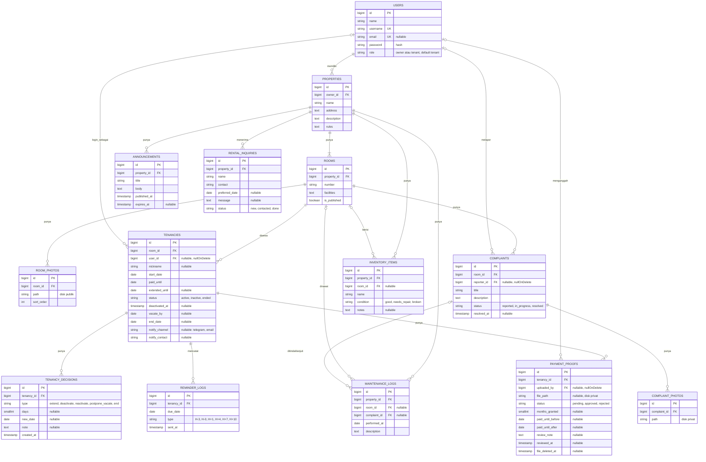

# Desain Database

Database: PostgreSQL. Tabel bawaan Laravel (`sessions`, `password_reset_tokens`, `cache`, `jobs`, `failed_jobs`, `notifications`) tidak digambar di sini.

Tidak ada kolom uang di tabel mana pun. Sistem tidak memproses pembayaran dan tidak menyimpan nominal transfer.

## ERD



Kolom `created_at`/`updated_at` (`timestamps()`) ada di semua tabel kecuali `tenancy_decisions` dan `reminder_logs`, yang hanya mencatat waktu kejadian. Kolom 2FA dan `remember_token` bawaan Fortify tetap ada di `users`.

## Data yang disimpan tentang penghuni

Hanya ini:

- `nickname` dan kamar, untuk identifikasi.
- `start_date` dan `paid_until`, untuk pengingat.
- Akun login (opsional): `username`, `password`, dan `email` (opsional).
- Satu kontak notifikasi (opsional): `notify_channel` + `notify_contact`. Untuk Telegram, isinya `chat_id` yang didapat otomatis saat penghuni membuka link bot dan menekan Start.

**Tidak disimpan:** NIK, foto KTP, alamat asal, tanggal lahir, tempat kerja/kampus, kontak darurat. Data ini dicek atau dicatat offline oleh pemilik.

## Aturan dan batasan

### Status kamar (dihitung, tidak disimpan)

- **Terisi:** kamar punya sewa berstatus `active` atau `inactive`. Penghuni nonaktif masih menempati kamar sampai `vacate_by`.
- **Tersedia:** tidak ada sewa seperti itu.
- `rooms.is_published = false` menyembunyikan kamar dari halaman publik.
- Halaman publik hanya menampilkan "tersedia/terisi", tanpa nama penghuni.

### Satu kamar, satu sewa yang menempati

Dijaga di level database dengan partial unique index (raw SQL di migration `tenancies`):

```sql
CREATE UNIQUE INDEX tenancies_room_occupying_unique
    ON tenancies (room_id)
    WHERE status IN ('active', 'inactive');
```

### Pembayaran dan masa tenggang

Semua tanggal dihitung dalam zona waktu **Asia/Jakarta**. Batas yang berlaku adalah `extended_until` kalau terisi, selain itu `paid_until`.

| Kondisi (dibanding `paid_until`) | Status turunan                        | Akses penghuni                   |
| -------------------------------- | ------------------------------------- | -------------------------------- |
| Hari ini ≤ `paid_until`          | Lancar                                | Normal                           |
| H+1 sampai H+7                   | Masa tenggang                         | Normal, menerima notifikasi      |
| H+8 sampai H+9                   | Lewat batas                           | Normal, tanpa notifikasi baru    |
| H+10 dan seterusnya              | Perlu keputusan pemilik               | Normal sampai pemilik memutuskan |
| `extended_until` terlewat        | Perlu keputusan (tanpa tenggang baru) | Normal sampai pemilik memutuskan |

- Bukti **disetujui:** `paid_until` maju `months_granted` bulan (default 1) dengan `addMonthsNoOverflow`. `extended_until` dikosongkan. Kalau sewa `inactive`, statusnya kembali `active` dan `deactivated_at`/`vacate_by` dikosongkan. Nilai sebelum/sesudah disimpan di `payment_proofs`.
- Bukti **ditolak:** `review_note` wajib diisi sebagai alasan.
- Kalau masih ada bukti `pending`, pemilik diminta memverifikasinya sebelum bisa menonaktifkan.
- Setiap keputusan pemilik dicatat di `tenancy_decisions`.

### Pengingat tanpa duplikat

`reminder_logs` punya unique key `(tenancy_id, due_date, type)`. Scheduler yang berjalan dua kali tidak mengirim pengingat ganda.

### Penghuni keluar (status `ended`)

Hanya terjadi setelah pemilik mengonfirmasi kamar sudah kosong:

1. Akun `users` penghuni dihapus. FK yang menunjuk ke akun itu otomatis menjadi `NULL` (`nullOnDelete`).
2. `nickname` dan `notify_contact` dikosongkan, `status = ended`, dan `end_date` diisi.
3. File bukti transfer dihapus (`file_path = NULL`, `file_deleted_at` diisi). Barisnya tetap ada.
4. Riwayat keluhan, perawatan, dan masa sewa tetap tersimpan tanpa identitas.

### File

- `room_photos`: disk `public`.
- `complaint_photos` dan `payment_proofs`: disk privat. Hanya bisa dibuka lewat route yang mengecek Policy (pemilik, atau penghuni pemilik data). Batasi tipe file (jpg/png, bukti juga pdf) dan ukurannya, lalu ganti nama file saat disimpan.
- File bukti transfer dihapus otomatis beberapa bulan setelah ditinjau. Catatannya tetap disimpan.

### Lain-lain

- `rental_inquiries` dihapus otomatis beberapa waktu setelah statusnya `done`.
- `maintenance_logs`/`inventory_items` dengan `room_id` kosong berarti area umum (dapur, kamar mandi bersama).
- Nilai tetap (role dan semua kolom status/type) memakai enum PHP berbasis string di `app/Enums`.
