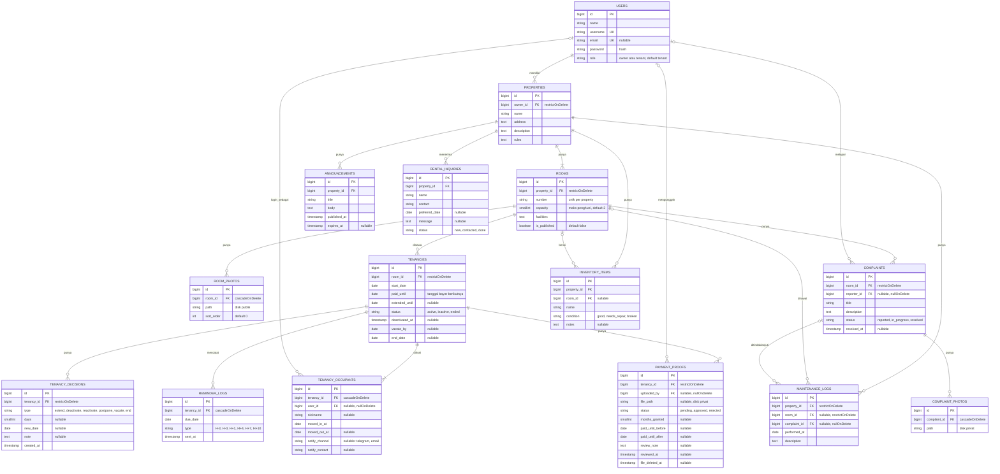

# Desain Database

Database: PostgreSQL. Tabel bawaan Laravel (`sessions`, `password_reset_tokens`, `cache`, `jobs`, `failed_jobs`, `notifications`) tidak digambar di sini.

Tidak ada kolom uang di tabel mana pun. Sistem tidak memproses pembayaran dan tidak menyimpan nominal transfer.

## ERD



Kolom `created_at`/`updated_at` (`timestamps()`) ada di semua tabel kecuali `tenancy_decisions` dan `reminder_logs`, yang hanya mencatat waktu kejadian. Kolom 2FA dan `remember_token` bawaan Fortify tetap ada di `users`.

## Data yang disimpan tentang penghuni

Hanya ini:

- `nickname` dan kamar, untuk identifikasi.
- `moved_in_at` dan `moved_out_at`, tanggal masuk dan keluar tiap penghuni.
- `start_date` dan `paid_until` milik sewa kamar (bukan per orang), untuk pengingat.
- Akun login (opsional): `username`, `password`, dan `email` (opsional).
- Satu kontak notifikasi per penghuni (opsional): `notify_channel` + `notify_contact`. Untuk Telegram, isinya `chat_id` yang didapat otomatis saat penghuni membuka link bot dan menekan Start.

**Tidak disimpan:** NIK, foto KTP, alamat asal, tanggal lahir, tempat kerja/kampus, kontak darurat. Data ini dicek atau dicatat offline oleh pemilik.

## Aturan dan batasan

### Status kamar (dihitung, tidak disimpan)

- **Terisi:** kamar punya sewa berstatus `active` atau `inactive`. Penghuni nonaktif masih menempati kamar sampai `vacate_by`.
- **Tersedia:** tidak ada sewa seperti itu.
- Jumlah penghuni tidak memengaruhi status. Kamar berisi 1 orang tetap **terisi**, karena penghuni kedua hanya masuk bersama atau atas ajakan penghuni pertama.
- `rooms.is_published = false` (default) menyembunyikan kamar dari halaman publik, sehingga kamar baru tidak tampil sebelum pemilik siap.
- Halaman publik hanya menampilkan "tersedia/terisi", tanpa nama penghuni.

### Satu kamar, satu sewa yang menempati

Dijaga di level database dengan partial unique index (raw SQL di migration `tenancies`):

```sql
CREATE UNIQUE INDEX tenancies_room_occupying_unique
    ON tenancies (room_id)
    WHERE status IN ('active', 'inactive');
```

### Penghuni per kamar

Satu sewa (`tenancies`) adalah satu tagihan untuk satu kamar. Orang yang tinggal di kamar itu dicatat di `tenancy_occupants`.

- **Penghuni aktif:** baris dengan `moved_out_at` kosong. Jumlahnya maksimal `rooms.capacity` (default 2).
- Batas jumlah dicek di aplikasi saat pemilik menambah penghuni, di dalam transaksi yang mengunci baris sewa (`lockForUpdate`). Index PostgreSQL tidak bisa membatasi jumlah baris.
- Penghuni kedua bisa ditambahkan kapan saja ke sewa yang sama selama masih ada tempat. Tanggal jatuh temponya mengikuti sewa kamar.
- Sewa `active`/`inactive` selalu punya minimal satu penghuni aktif. Kalau penghuni aktif terakhir keluar, sewa ikut berakhir (lihat "Penghuni keluar").
- Satu akun hanya boleh aktif di satu kamar. Penghuni tanpa akun (`user_id` kosong) tidak terkena aturan ini, karena unique index PostgreSQL menganggap setiap `NULL` berbeda:

```sql
CREATE UNIQUE INDEX tenancy_occupants_user_active_unique
    ON tenancy_occupants (user_id)
    WHERE moved_out_at IS NULL;
```

- Harga sewa (berbeda untuk 1 dan 2 orang) tidak disimpan dan tidak ditampilkan. Pemilik mencatatnya di luar sistem.

### Pembayaran dan masa tenggang

`paid_until` adalah **tanggal bayar berikutnya** (jatuh tempo), bukan hari terakhir yang sudah dibayar. Contoh: penghuni masuk 1 Januari dan membayar 1 bulan di muka, maka `paid_until` = 1 Februari. Pada 1 Februari (H-0) penghuni masih lancar, dan baru terlambat mulai 2 Februari (H+1). Saat sewa dibuat, pemilik mengisi `paid_until` = `start_date` + jumlah bulan yang dibayar di muka.

Semua tanggal dihitung dalam zona waktu **Asia/Jakarta**. Batas yang berlaku adalah `extended_until` kalau terisi, selain itu `paid_until`.

| Kondisi (dibanding `paid_until`) | Status turunan                        | Akses penghuni                   |
| -------------------------------- | ------------------------------------- | -------------------------------- |
| Hari ini ≤ `paid_until`          | Lancar                                | Normal                           |
| H+1 sampai H+7                   | Masa tenggang                         | Normal, menerima notifikasi      |
| H+8 sampai H+9                   | Lewat batas                           | Normal, tanpa notifikasi baru    |
| H+10 dan seterusnya              | Perlu keputusan pemilik               | Normal sampai pemilik memutuskan |
| `extended_until` terlewat        | Perlu keputusan (tanpa tenggang baru) | Normal sampai pemilik memutuskan |

- Bukti bisa diunggah oleh penghuni aktif mana pun di kamar itu, dan berlaku untuk sewa kamarnya.
- Bukti **disetujui:** `paid_until` maju `months_granted` bulan (default 1) dengan `addMonthsNoOverflow`. `extended_until` dikosongkan. Kalau sewa `inactive`, statusnya kembali `active` dan `deactivated_at`/`vacate_by` dikosongkan. Nilai sebelum/sesudah disimpan di `payment_proofs`.
- Bukti **ditolak:** `review_note` wajib diisi sebagai alasan.
- Kalau masih ada bukti `pending`, pemilik diminta memverifikasinya sebelum bisa menonaktifkan.
- Setiap keputusan pemilik dicatat di `tenancy_decisions`.

### Pengingat tanpa duplikat

`reminder_logs` punya unique key `(tenancy_id, due_date, type)`. Scheduler yang berjalan dua kali tidak mengirim pengingat ganda. Satu pengingat dikirim ke semua penghuni aktif kamar itu, dan dicatat satu kali per sewa.

### Penghuni keluar

Akun tidak pernah dihapus otomatis. Semua langkah di bawah baru dijalankan setelah pemilik mengonfirmasi.

**Satu penghuni keluar, sewa berlanjut** (teman sekamarnya tetap tinggal):

1. `moved_out_at` diisi.
2. File bukti transfer yang diunggahnya dihapus (`file_path = NULL`, `file_deleted_at` diisi). Langkah ini dilakukan **sebelum** akun dihapus, karena setelah itu `uploaded_by` menjadi `NULL` dan file tidak bisa dilacak lagi ke pengunggahnya.
3. Akun `users` penghuni itu dihapus. FK yang menunjuk ke akun itu otomatis menjadi `NULL` (`nullOnDelete`).
4. `nickname` dan `notify_contact` di baris penghuninya dikosongkan.
5. Sewa kamar dan `paid_until` tetap berjalan. Perubahan harga karena penghuni berkurang dicatat pemilik di luar sistem.

**Semua penghuni keluar** (status `ended`), setelah pemilik mengonfirmasi kamar sudah kosong:

1. Setiap penghuni aktif diproses seperti di atas.
2. `status = ended` dan `end_date` diisi.
3. Semua file bukti transfer sewa itu dihapus. Barisnya tetap ada.
4. Riwayat keluhan, perawatan, dan masa sewa tetap tersimpan tanpa identitas.

### Hapus data (foreign key)

- FK ke `users` milik penghuni (`tenancy_occupants.user_id`, `payment_proofs.uploaded_by`, `complaints.reporter_id`): `nullOnDelete`, agar riwayat tetap ada setelah akun dihapus.
- `properties.owner_id` dan `rooms.property_id`: `restrictOnDelete`. Akun pemilik dan kost tidak bisa terhapus selama masih punya kost atau kamar, sehingga riwayat sewa tidak ikut hilang.
- `tenancies.room_id`: `restrictOnDelete`. Kamar yang punya riwayat sewa tidak bisa dihapus.
- `payment_proofs.tenancy_id` dan `tenancy_decisions.tenancy_id`: `restrictOnDelete`. Bukti pembayaran (beserta filenya) dan jejak keputusan pemilik tidak boleh ikut hilang diam-diam.
- `reminder_logs.tenancy_id`: `cascadeOnDelete`, karena isinya hanya data teknis untuk mencegah pengingat ganda.
- `complaints.room_id`, `maintenance_logs.property_id`, dan `maintenance_logs.room_id`: `restrictOnDelete`, agar riwayat keluhan dan perawatan tidak hilang. `room_id` perawatan tidak memakai `nullOnDelete`, karena `NULL` di kolom itu berarti area umum.
- `complaint_photos.complaint_id`: `cascadeOnDelete` (foto adalah bagian dari keluhan, file di disk dihapus oleh aplikasi).
- `maintenance_logs.complaint_id`: `nullOnDelete`. Catatan perawatan tetap ada walaupun keluhannya dihapus.
- `room_photos.room_id` dan `tenancy_occupants.tenancy_id`: `cascadeOnDelete`, karena barisnya adalah bagian dari kamar atau sewa. Cascade hanya menghapus baris database. File foto di disk tetap harus dihapus oleh aplikasi.
- `rooms` punya unique `(property_id, number)` agar tidak ada nomor kamar kembar dalam satu kost.
- FK tabel lain ditentukan saat migration tabelnya dibuat.

### File

- `room_photos`: disk `public`.
- `complaint_photos` dan `payment_proofs`: disk privat. Hanya bisa dibuka lewat route yang mengecek Policy. Foto keluhan: pemilik dan penghuni aktif kamar itu. Gambar bukti transfer: pemilik dan pengunggahnya saja, karena biasanya memuat nama dan nomor rekening bank. Batasi tipe file (jpg/png, bukti juga pdf) dan ukurannya, lalu ganti nama file saat disimpan.
- File bukti transfer dihapus otomatis beberapa bulan setelah ditinjau. Catatannya tetap disimpan.

### Lain-lain

- `rental_inquiries` dihapus otomatis beberapa waktu setelah statusnya `done`.
- `maintenance_logs`/`inventory_items` dengan `room_id` kosong berarti area umum (dapur, kamar mandi bersama).
- Nilai tetap (role dan semua kolom status/type) memakai enum PHP berbasis string di `app/Enums`.
